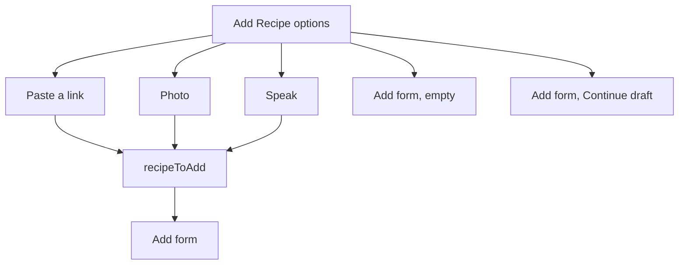

# Adding a recipe

Typing, a link, a photo, and voice all land on the same add form. The form also keeps a local draft and applies an AI edit in place. Parsing a link, photo, or transcript is the API's job. Those paths are documented in SharedCookbook: `docs/features/recipe-from-url.md`, `docs/features/recipe-from-photo.md`, and `docs/features/recipe-from-voice.md`. This doc is what the app does around those calls.

## Where each option goes

The + inside a cookbook opens Add Recipe ([add-options.tsx](<../../app/(logged-in)/recipe/add-options.tsx>)). The recipe is added to that cookbook.

| Option | Next screen | Counts toward the weekly cap |
| --- | --- | --- |
| Link | [select-url.tsx](<../../app/(logged-in)/recipe/select-url.tsx>) | On a successful parse |
| Photo | [add-photo.tsx](<../../app/(logged-in)/recipe/add-photo.tsx>) | On a successful parse |
| Voice | [add-voice.tsx](<../../app/(logged-in)/recipe/add-voice.tsx>) | On a successful parse |
| Type it in | [add.tsx](<../../app/(logged-in)/recipe/add.tsx>) | No |
| Continue draft | Add form, with `continueDraft=1` | No |

A successful link, photo, or voice parse opens the add form with the parsed recipe in `recipeToAdd`.

## Link, photo, and voice

**Link.** The paste screen strips spaces and rejects a blank or invalid URL before any request. [recipeImportUrl.ts](../../utils/recipeImportUrl.ts) rejects a long-form YouTube link on the device (`youtube.com`, `youtube-nocookie.com`, `youtu.be` outside `/shorts`). TikTok, Instagram, Pinterest, `pin.it`, and a YouTube Short call `extractRecipeFromSocialUrl`, which posts `extractFromVideo: true`. Every other URL calls `extractRecipeFromUrl` with no video flag. The server's host rules are in SharedCookbook `docs/features/recipe-from-url.md`. Both calls wait out `RECIPE_IMPORT_MIN_LOADING_MS` (1.5s) so the loading screen does not flash, then show a rate-limit, timeout, or extract-failed message and stay on the paste screen.

**Photo.** An action sheet offers the camera or the camera roll. A denied permission or a failed parse stays on this screen with an error. A success replaces to the add form.

**Voice.** Speech recognition is on the device (`expo-speech-recognition`). The screen moves idle → recording → review → processing. The person can edit the transcript before Build Recipe. Recording stops on Done, on the recognizer's end event, or after 5 minutes. The locale comes from [getSpeechRecognitionLocale](../../i18n/language.ts): the device tag when it matches the app language, otherwise `en-US`, `fr-FR`, or `ko-KR`. A denied microphone permission stays on idle. A failed parse returns to review. The API only receives the transcript (SharedCookbook `docs/features/recipe-from-voice.md`).

If the payload in `recipeToAdd` has no saveable content, the add form clears it and returns to Add Recipe options.

## What fills the form

The add form resolves its initial values in this order:

1. `recipeToAdd`, when it has saveable content.
2. The draft for `cookbookId` (or the selected cookbook), and only when the route has `continueDraft=1`.
3. An empty form.

Opening the add form any other way does not restore a draft. `recipeToAdd` is cleared when the form unmounts, and it is not in the persisted slice of `ui-v1`, so a reload between a successful parse and the form drops the import.

Continue draft on the options screen is the newest draft that has content, across cookbooks. Tapping it selects that cookbook, then opens the form with `continueDraft=1`.

## Drafts

Drafts live in the Zustand `ui` store (`ui-v1`) and survive a reload. There is one draft per cookbook. Saving again replaces that row and keeps its `draftId`.

The add form writes the draft from its unmount cleanup:

| Leaving the form | Draft |
| --- | --- |
| Save succeeded | Deleted. `submittedSuccessfullyRef` stops the cleanup from writing it back |
| Save threw | Written, then the failure alert |
| Form has saveable content | Written for the selected cookbook |
| Form was dirtied, or this visit restored a draft, and nothing saveable remains | Deleted |
| Pristine and empty | Left alone |

A draft has content when the summary, an image, a direction, an ingredient, a section title, or a real title is non-empty. The title `untitled recipe` does not count. Empty drafts are dropped when the options screen focuses and when `ui-v1` rehydrates.

A successful save also marks the getting-started recipe step done, then dismisses to Cookbooks and pushes the cookbook. The walk itself is in [getting-started-tour.md](./getting-started-tour.md).

## AI edit

The add form and the edit form ([recipe/[id]/edit.tsx](<../../app/(logged-in)/recipe/[id]/edit.tsx>)) share the AI dialog. Type or speak a change. Apply sends the current form values to `POST /api/Recipes/apply-prompt`. A success replaces those values and remounts the form. It does not write `recipeToAdd` and does not save the recipe. Leaving the add form afterward persists the result as a draft, by the unmount rules above. The edit form has no draft.

A successful apply increments the same weekly counter as an import. At the cap, the button shows a lock and opens the paywall instead of the dialog.

## Weekly cap

Free accounts get `WEEKLY_IMPORT_LIMIT` (5) successful imports and AI applies per local week. The counter is `weeklyImportCount` plus `weeklyImportWeekStart` in `ui-v1`. The week key is the local Monday as `YYYY-MM-DD`, so an evening import stays in that week the next morning.

The options screen and both forms treat the count as 0 when the stored week is not current. A stored key still counts as current from the day before this Monday through the day before next Monday, so a key written by an older build as a UTC date (one day off) does not look expired on Monday. The next increment is stricter: it resets to 1 whenever the stored key is not exactly this Monday.

Pro skips the gate. `isPro` comes from the RevenueCat `pro` entitlement in [subscriptionStore.ts](../../stores/subscriptionStore.ts). The counter still increments. The options screen shows an unlimited banner instead of the usage line. Link, photo, voice, and the AI button route to the paywall once a free account is at the cap. Type it in and Continue draft stay available. The row looks disabled, and the press handler is what opens the paywall.

This cap is on the device. The API has its own daily parse quota per tier, documented in SharedCookbook `docs/features/subscriptions.md`.

## Where to look in code

| Area | Path |
| --- | --- |
| Options, paste, photo, voice, form | [app/(logged-in)/recipe/](<../../app/(logged-in)/recipe/>) |
| Import mutations and the weekly increment | [hooks/queries/useRecipesQuery.ts](../../hooks/queries/useRecipesQuery.ts) |
| URL classification | [utils/recipeImportUrl.ts](../../utils/recipeImportUrl.ts) |
| Draft shape, week key, "has content" | [utils/recipeDraftHelpers.ts](../../utils/recipeDraftHelpers.ts) |
| Persisted drafts and `recipeToAdd` | [stores/uiStore.ts](../../stores/uiStore.ts) |
| Minimum loading wait | [utils/minimumLoadingDelay.ts](../../utils/minimumLoadingDelay.ts) |
| Pro entitlement | [stores/subscriptionStore.ts](../../stores/subscriptionStore.ts) |
