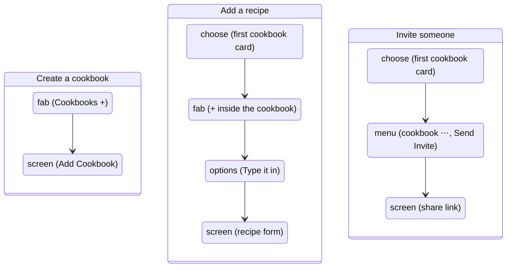

# Getting started tour

New accounts see a **Get started** checklist at the top of the Cookbooks tab. It has three steps: create a cookbook, add a recipe, invite someone. Tapping a step starts a **guided walk** that spotlights the real controls across several screens, one at a time.

There are no dedicated tutorial screens. Every walk uses the same buttons a person would use anyway: the floating + on Cookbooks, a cookbook card, the + inside a cookbook, and the cookbook ⋯ menu.

## Two pieces of state

| Piece     | Lives in                                                                   | Survives a reload | What it holds                                             |
| --------- | -------------------------------------------------------------------------- | ----------------- | --------------------------------------------------------- |
| Checklist | MMKV, per account                                                          | Yes               | Which steps are done, whether the checklist was dismissed |
| Walk      | Module memory ([gettingStartedTour.ts](../../utils/gettingStartedTour.ts)) | No                | The step being walked and its current phase               |

The walk is an external store read with `useSyncExternalStore`. Any screen can read it with `useGettingStartedTour()` or `getGettingStartedTour()`. A reload drops the walk, but the checklist keeps every finished step.

### Storage keys

| Key                                   | Scope   | Meaning                                                      |
| ------------------------------------- | ------- | ------------------------------------------------------------ |
| `gettingStarted.seen.{step}.{userId}` | Account | Step is done                                                 |
| `hasDismissedGettingStarted.{userId}` | Account | Checklist hidden ("Explore on my own", or every step done)   |
| `gettingStarted.expanded`             | Device  | Checklist card is expanded                                   |
| `gettingStarted.devPreview`           | Device  | Dev only. Forces the checklist on while a step is still open |

Keys are scoped by account so one person's progress doesn't hide the checklist for the next person signed in on the same device.

## Checklist rules

Every step is always listed. Locked steps are greyed out, show a lock, and can't be tapped.

| Step              | Unlocked when              | Done when                                        |
| ----------------- | -------------------------- | ------------------------------------------------ |
| Create a cookbook | Always                     | Its flag is set, or the account has any cookbook |
| Add a recipe      | The account has a cookbook | Its flag is set                                  |
| Invite someone    | The recipe step is done    | Its flag is set                                  |

- The cookbook step also writes its flag as soon as the list loads with a cookbook, so it stays done if that cookbook is later left or deleted.
- The badge on the card header counts every unfinished step, locked or not. A new account sees 3.
- When the last step finishes, the card plays its exit animation the next time Cookbooks is focused, then sets the dismissed flag.

Rules are pure functions in [gettingStarted.ts](../../utils/gettingStarted.ts): `isGettingStartedStepUnlocked`, `isCookbookStepDone`, `pendingGettingStartedCount`, `shouldShowGettingStarted`.

## Walks

Every walk starts on the Cookbooks tab. A walk is a **step** plus a **phase**, and each screen sets the phase it owns when it gains focus:

```ts
useFocusEffect(
  useCallback(() => {
    if (getGettingStartedTour()?.step === "recipe") advanceGettingStartedTour("options")
  }, []),
)
```

So going back rewinds the walk on its own. Backing out of Add Recipe options into the cookbook puts the walk back on the + button, with no explicit "previous" handling.



| Screen             | Phase it sets                                                           | What the guide shows                                              |
| ------------------ | ----------------------------------------------------------------------- | ----------------------------------------------------------------- |
| Cookbooks tab      | `fab` (cookbook walk) or `choose` (others), via `cookbooksTabTourPhase` | Spotlight on the floating +, or on the first cookbook card        |
| Add Cookbook       | `screen`                                                                | Light scrim over the form with Got it                             |
| Cookbook detail    | `fab` (recipe) or `menu` (invite), via `cookbookDetailTourPhase`        | Spotlight on the + button, or a note pointing up at the ⋯ menu    |
| Add Recipe options | `options`                                                               | Spotlight on "Type it in"                                         |
| Add Recipe form    | `screen`                                                                | Light scrim over the form with Got it                             |
| Invite Friends     | `screen`                                                                | Spotlight on the share-link card with Got it. Email is outside it |

### Cookbook detail specifics

- **Menu phase.** The ⋯ lives in the navigation header, which sits above the guide overlay. That button can't be cut out of the overlay, so the header renders a tinted ⋯ with a ring and the note points up at it (`targetAbove` in the guide). When the menu opens, the Popover outlines **Send Invite** through `highlightKey`.
- **Permissions.** The + and Send Invite only show for members who can use them. `canAddRecipe` and `canSendInvite` in [membershipTier.ts](../../utils/membershipTier.ts) mirror the backend rule: Contributor tier and up. Until the membership loads, the screen assumes the person is allowed, and the API still enforces it. A Viewer who opens a cookbook mid-walk sees "You can only view this cookbook" instead of a spotlight on a missing button.

## Ending a walk

| How                                                                               | Step       | Where the person ends up           |
| --------------------------------------------------------------------------------- | ---------- | ---------------------------------- |
| Got it on Add Cookbook or the recipe form                                         | Done       | Stays on that screen to keep going |
| Got it on Invite Friends                                                          | Done       | Stays on the link screen           |
| Tap the dimmed area on a final screen (Add Cookbook, recipe form, Invite Friends) | Still open | Stays on that screen               |
| Tap the dimmed area mid-walk                                                      | Still open | Back on Cookbooks                  |
| Do the real thing (see below)                                                     | Done       | Wherever that action normally goes |

The matching functions in [gettingStartedTour.ts](../../utils/gettingStartedTour.ts):

| Function                                   | Sets the flag | Ends the walk                     | Returns to Cookbooks |
| ------------------------------------------ | ------------- | --------------------------------- | -------------------- |
| `completeGettingStartedTour`               | Yes           | Yes                               | No                   |
| `completeGettingStartedTourToChecklist`    | Yes           | Yes                               | Yes                  |
| `markGettingStartedStepDone(userId, step)` | Yes           | Only if that step is being walked | No                   |
| `endGettingStartedTour`                    | No            | Yes                               | No                   |
| `leaveGettingStartedTour`                  | No            | Yes                               | Yes                  |

### Real actions check steps off

A step is done once the person actually does it, with or without a walk running. Each of these calls `markGettingStartedStepDone`:

| Action                       | Where                                                                        | Notes                                                                                             |
| ---------------------------- | ---------------------------------------------------------------------------- | ------------------------------------------------------------------------------------------------- |
| Cookbook saved               | [cookbook/add.tsx](<../../app/(logged-in)/cookbook/add.tsx>)                 |                                                                                                   |
| Recipe saved                 | [recipe/add.tsx](<../../app/(logged-in)/recipe/add.tsx>)                     | Link, photo, and voice imports all land in this form, so they count too                           |
| Email invite sent            | [invitation/add-email.tsx](<../../app/(logged-in)/invitation/add-email.tsx>) | Only when `invite()` returns `sent: true`. Unknown email, already invited, and errors don't count |
| Invite link copied or shared | [invitation/add-link.tsx](<../../app/(logged-in)/invitation/add-link.tsx>)   | iOS reports a cancelled share sheet, which doesn't count. Android always reports shared           |

Ending the walk here matters. Saving a recipe navigates back through Cookbooks into the cookbook, and a walk left running would restart at "Tap + to add a recipe".

## The guide overlay

[GettingStartedGuide](../../components/cookbooks/GettingStartedGuide.tsx) is rendered by each screen, absolutely positioned over it. `useGuideAnchor(active)` gives a ref to put on the target view and measures it with `measureInWindow` on the next frame and on every layout.

| Mode        | When                                           | Look                                                                                                          |
| ----------- | ---------------------------------------------- | ------------------------------------------------------------------------------------------------------------- |
| Spotlight   | A target below the overlay                     | Four dimmed Pressables around a hole, a tinted ring, and a pulse. Taps inside the hole reach the real control |
| Pointing up | The target is above the overlay (the header ⋯) | Full dim, the note pinned to the top with an arrow under the target                                           |
| Reveal      | `revealScreen`                                 | A light scrim over the whole screen, note at the bottom                                                       |

The note sits below the hole when there's room and flips above it otherwise. If flipping above would cover the target, the note stays below. Room is the overlay's own layout height, stopping at the system navigation bar, so the notes on the floating + buttons (create a cookbook, add a recipe) point down at the icon. The Invite Friends note sits under the share-link card. That guide is a sibling of the screen, so the dim covers the email row under the card. A tap there ends the walk and stays on the screen. The note stays hidden until that layout is measured, so it does not flash beside the control. Every dimmed area calls `onClose`.

## Development

Profile tab → Debug (dev builds only):

- **Preview getting started** clears this account's step and dismissed flags (`gettingStartedResetKeys`), sets `gettingStarted.devPreview`, and goes to Cookbooks. The cookbook step still reads as done if the account already has a cookbook.
- With dev preview on, saving a cookbook opens it even if the account already had others (`shouldOpenCookbookAfterCreate`), so the empty-cookbook state can be seen on an existing account.

## Where to look in code

| Area                                          | Path                                                                                                                                                                                                                                                                         |
| --------------------------------------------- | ---------------------------------------------------------------------------------------------------------------------------------------------------------------------------------------------------------------------------------------------------------------------------- |
| Step rules, phases, storage keys              | [utils/gettingStarted.ts](../../utils/gettingStarted.ts)                                                                                                                                                                                                                     |
| Walk store and end/complete helpers           | [utils/gettingStartedTour.ts](../../utils/gettingStartedTour.ts)                                                                                                                                                                                                             |
| Checklist card                                | [components/cookbooks/GettingStartedCard.tsx](../../components/cookbooks/GettingStartedCard.tsx)                                                                                                                                                                             |
| Guide overlay and anchor hook                 | [components/cookbooks/GettingStartedGuide.tsx](../../components/cookbooks/GettingStartedGuide.tsx)                                                                                                                                                                           |
| Floating + button                             | [components/FloatingActionButton.tsx](../../components/FloatingActionButton.tsx)                                                                                                                                                                                             |
| Popover highlight                             | [components/Popover.tsx](../../components/Popover.tsx)                                                                                                                                                                                                                       |
| Cookbooks tab (checklist, `fab` and `choose`) | [app/(logged-in)/(tabs)/cookbooks.tsx](<../../app/(logged-in)/(tabs)/cookbooks.tsx>)                                                                                                                                                                                         |
| Cookbook detail (`fab` and `menu`)            | [app/(logged-in)/cookbook/[id]/index.tsx](<../../app/(logged-in)/cookbook/[id]/index.tsx>)                                                                                                                                                                                   |
| Final and options screens                     | [cookbook/add.tsx](<../../app/(logged-in)/cookbook/add.tsx>), [recipe/add-options.tsx](<../../app/(logged-in)/recipe/add-options.tsx>), [recipe/add.tsx](<../../app/(logged-in)/recipe/add.tsx>), [invitation/add-link.tsx](<../../app/(logged-in)/invitation/add-link.tsx>) |
| Permission helpers                            | [utils/membershipTier.ts](../../utils/membershipTier.ts)                                                                                                                                                                                                                     |
| Copy                                          | `gettingStarted` section in [i18n/en.ts](../../i18n/en.ts) (plus `fr.ts`, `ko.ts`)                                                                                                                                                                                           |
| Tests                                         | [utils/gettingStarted.test.ts](../../utils/gettingStarted.test.ts), [utils/membershipTier.test.ts](../../utils/membershipTier.test.ts)                                                                                                                                       |
